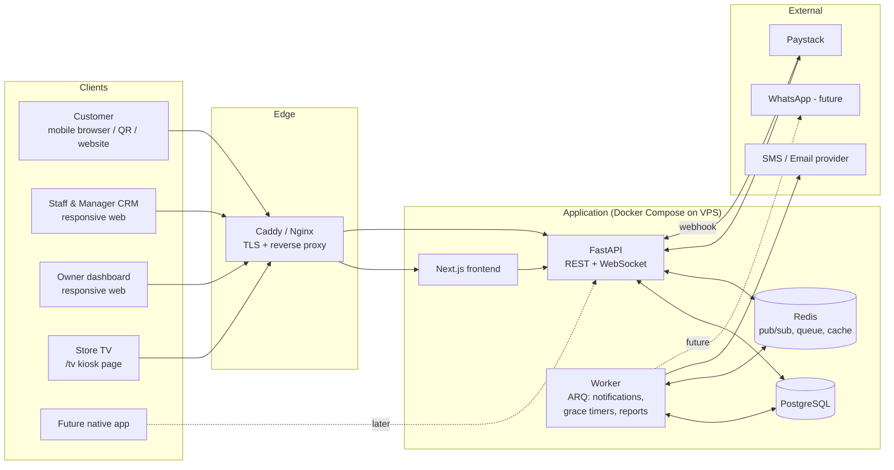
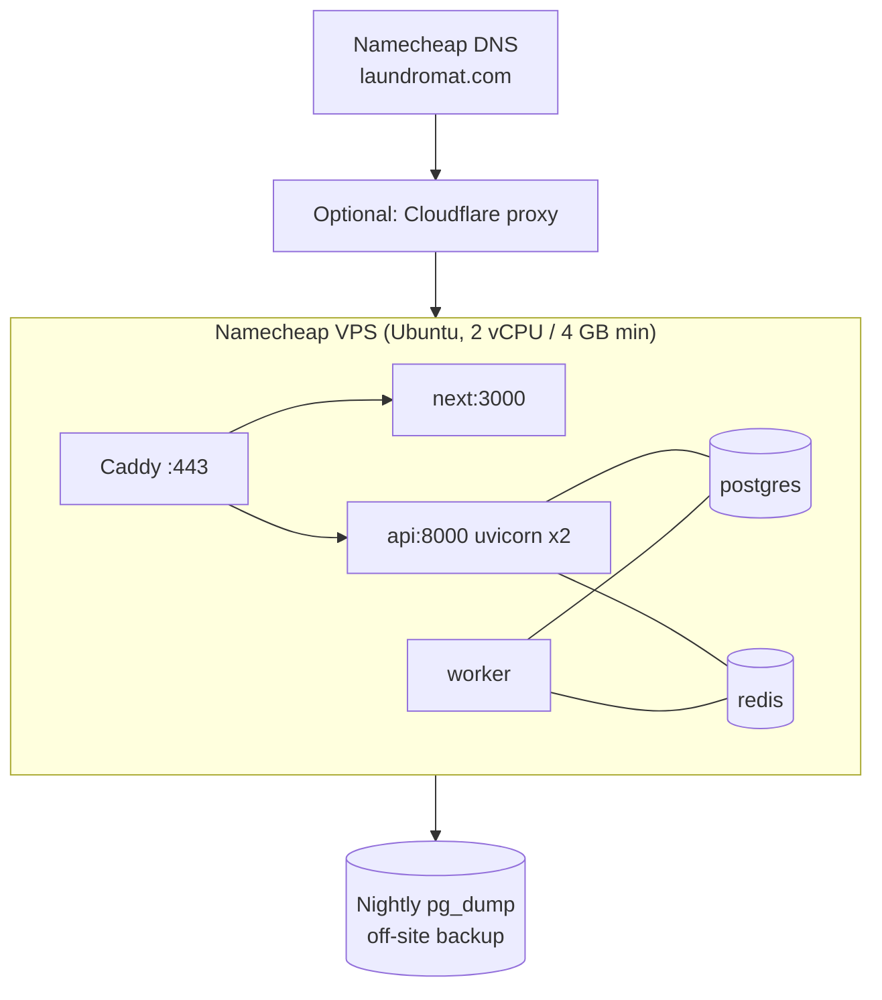
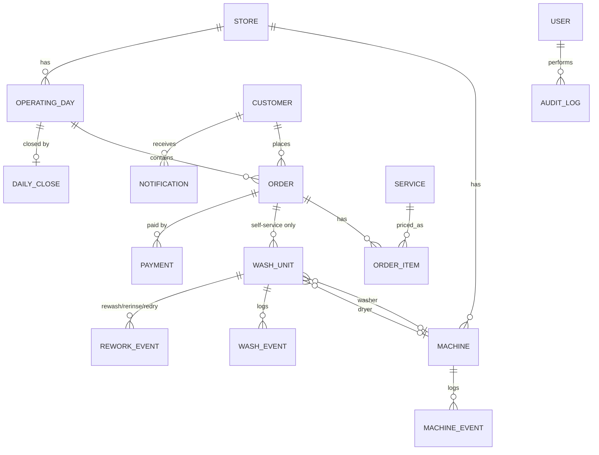
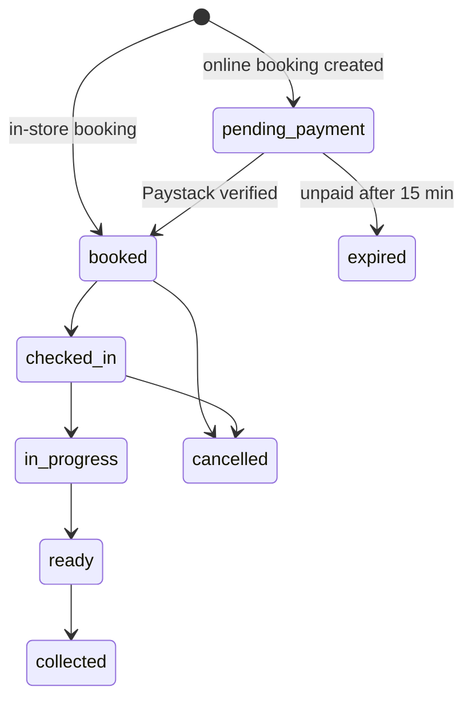
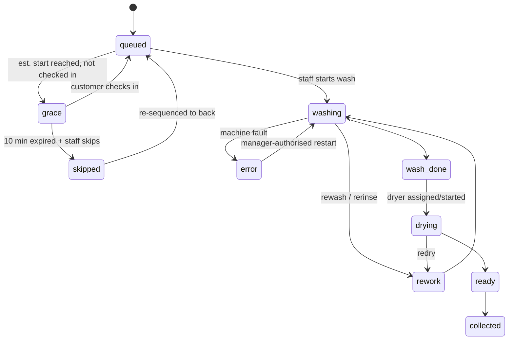
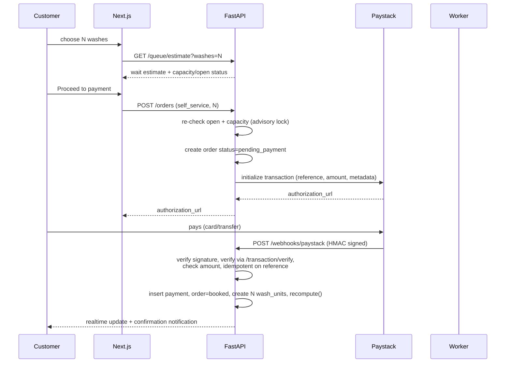

# LAUNDROMAT: System Architecture

> Version 1.0 · MVP scope · Timezone `Africa/Lagos` · Currency NGN (stored in kobo)

This document is the technical source of truth for building the LAUNDROMAT CRM, queue, POS and operations system. The product requirements live in the original brief; the screens are the 14 UI mockups. The most critical component, the **queue engine**, is specified in [section 5](#5-the-queue-engine-most-critical-component) and has a runnable prototype in `backend/app/queue/engine.py`.

---

## 1. Guiding principles

1. **The CRM is the single source of truth.** If a machine is busy in the store, it is busy in the database. Staff update physical reality; everything else derives from that.
2. **Count wash units and machine capacity, never customers.**
3. **Order ≠ Wash unit.** An order (`#1025`, 3 washes, ₦12,000) owns N independent wash units (`1025-1`, `1025-2`, `1025-3`) with their own queue position, machine, timings and rework.
4. **Estimates are projections; actions are facts.** The engine projects; staff actions (start wash, dry complete) record what really happened and trigger a re-projection.
5. **Append-only for money and accountability.** Payments, audit log and machine events are never edited, only corrected with new entries.
6. **API-first.** The web apps are just clients of a versioned REST + WebSocket API, so a native app can be added later without backend changes.
7. **Multi-branch ready, single-branch shipped.** Every operational table carries `store_id` from day one.
8. **Modular monolith.** One FastAPI codebase with clear module boundaries. No microservices for MVP.

---

## 2. High-level architecture



### Component responsibilities

| Component | Responsibility |
|---|---|
| **Next.js frontend** | Customer site, staff CRM, owner dashboard, `/tv` screen. One codebase using route groups: `(customer)`, `(staff)`, `(owner)`, `(tv)`. |
| **FastAPI API** | All business logic, auth, RBAC, queue engine invocation, Paystack integration, WebSocket gateway. |
| **Worker (ARQ)** | Sends notifications, runs the 15-second grace-period/approaching-turn scheduler, auto-expires unpaid online bookings, builds daily reports. |
| **PostgreSQL** | System of record. Advisory locks serialise queue mutations. |
| **Redis** | Pub/sub fan-out to WebSocket connections, job queue, cached queue snapshot, rate limiting. |
| **Paystack** | Online card/transfer payments. Verified server-side via webhook + verify API. |

### Technology choices

| Area | Choice | Why |
|---|---|---|
| Backend | Python 3.12, FastAPI, SQLAlchemy 2.0 (async), Alembic, Pydantic v2 | Matches stack; typed; auto OpenAPI for future mobile app. |
| Frontend | **Next.js (App Router) + TailwindCSS** | SSR for QR/landing pages, one deployable, good mobile performance. Plain React + Vite is an acceptable fallback. |
| Realtime | FastAPI WebSockets + Redis pub/sub, with SSE/polling fallback | Live queue, progress, TV. |
| Jobs | ARQ (async Redis queue) | Lighter than Celery, fits async FastAPI. |
| DB | PostgreSQL 16 | Transactions, advisory locks, JSONB for audit diffs, window functions for analytics. |
| Auth | JWT access (15 min) + rotating refresh tokens; phone OTP for customers; password + PIN for staff | Token auth works for browser and native app alike. |

---

## 3. Deployment (Namecheap)

**Important:** Namecheap *shared hosting* is not suitable for the backend. FastAPI needs a long-running ASGI process, WebSockets, Redis and a background worker. Use a **Namecheap VPS** (or any VPS) and keep Namecheap for the domain.



- **Docker Compose** services: `caddy`, `web`, `api`, `worker`, `postgres`, `redis`.
- **Domains:** `laundromat.com` (web, QR landing), `api.laundromat.com` (API/WebSocket).
- **TLS:** automatic via Caddy.
- **Backups:** nightly `pg_dump` to off-site storage (e.g., S3-compatible). Test a restore before launch.
- **Environments:** `local`, `staging` (small VPS or same VPS, separate compose project, Paystack *test* keys), `production`.
- **CI/CD:** GitHub Actions: lint, tests, build images, SSH deploy, run `alembic upgrade head`.
- **Store hardware:** staff tablet/PC browser; TV runs Chrome in kiosk mode on `/tv?token=...` (read-only device token). Plan for TV auto-reconnect.

---

## 4. Domain model

### 4.1 Entity relationships



### 4.2 Key tables

All tables: `id` (UUID), `store_id`, `created_at`, `updated_at`. Money columns are `BIGINT` kobo.

| Table | Key columns |
|---|---|
| `customers` | `customer_code` (public ID), `first_name`, `last_name`, `phone` (unique, E.164), `email`, `preferred_name`, `registered_via` (`online`/`in_store`), `registered_by_user_id`, `phone_verified_at`, `segment` |
| `users` | `email`, `password_hash`, `role` (`staff`/`manager`/`owner`), `pin_hash`, `is_active` |
| `operating_days` | `date`, `queue_opens_at`, `queue_closes_at`, `accepting_bookings`, `dropoff_open`, `dropoff_capacity`, `status` (`open`/`closed`) |
| `services` | `kind` (`self_service_wash`/`dropoff_wash`/`drink`/`coffee`/`other`), `name`, `unit_price`, `is_active` |
| `orders` | `order_no` (e.g. 1025), `customer_id`, `operating_day_id`, `type` (`self_service`/`dropoff`/`retail`), `channel` (`online`/`in_store`), `status`, `subtotal`, `discount`, `total`, `payment_status`, `checked_in_at`, `created_by_user_id` |
| `order_items` | `order_id`, `service_id`, `qty`, `unit_price`, `line_total` |
| `wash_units` | `order_id`, `unit_no` (`1025-1`), `queue_seq`, `status`, `washer_id`, `dryer_id`, `est_wash_start`, `est_ready_at`, `wash_started_at`, `wash_ended_at`, `dry_started_at`, `dry_ended_at`, `grace_started_at`, `grace_expires_at`, `skip_count`, `version` |
| `machines` | `kind` (`washer`/`dryer`), `label`, `status` (`available`/`running`/`error`/`maintenance`), `unavailable_until`, `current_wash_unit_id` |
| `machine_events` | `machine_id`, `type`, `wash_unit_id`, `reason`, `authorised_by`, `occurred_at` |
| `rework_events` | `wash_unit_id`, `type` (`rewash`/`rerinse`/`redry`), `reason`, `machine_id`, `started_at`, `ended_at`, `extra_minutes`, `staff_id` |
| `payments` | `order_id`, `method` (`paystack_card`/`paystack_transfer`/`transfer`/`pos`/`cash`/...), `amount`, `kind` (`payment`/`refund`), `status`, `paystack_reference` (unique), `fee`, `recorded_by`, `paid_at`. **Append-only.** |
| `notifications` | `customer_id`, `template`, `channel`, `status`, `payload`, `sent_at`, `dedupe_key` (unique) |
| `daily_closes` | `operating_day_id`, expected/actual by method, variance, notes, `closed_by`, `closed_at`, `snapshot` (JSONB). Immutable. |
| `audit_log` | `actor_user_id`, `action`, `entity_type`, `entity_id`, `before`, `after` (JSONB), `reason`, `ip`, `occurred_at`. **Append-only.** |
| `settings` | key/value (JSONB) per store, with history |

### 4.3 State machines

**Order**



**Wash unit** (what the customer sees per wash)



**Machine**: `available ⇄ running`, `running → error → available`, `* → maintenance → available`.

> "Customer status" (Registered, Booked, Checked in, Waiting, Washing, Drying, Ready, Collected, Skipped, Cancelled) is **derived** from the order and wash-unit states. It is not stored separately.

### 4.4 Order numbering and operating day

- `order_no` is a per-store sequence; wash units are `{order_no}-{n}`.
- An **operating day** is a row in `operating_days` with open/close times in `Africa/Lagos`. Bookings are only accepted when `now` is within the queue window, `accepting_bookings = true`, and projected wait ≤ max acceptable wait. Otherwise: *"Today's queue is currently closed. Please return tomorrow from 8:00 AM."* or *"We're currently at capacity…"*
- Dates are stored UTC; business-day logic always uses the store timezone.

---

## 5. The queue engine (most critical component)

### 5.1 What it answers

> "Toyin's next wash will enter **Washer 1 at 9:54 AM**, her second wash **Washer 3 at 10:08 AM**."

### 5.2 Inputs (snapshot)

| Input | Source |
|---|---|
| `now` | passed in (never read inside the engine) |
| Washers: available?, in-flight wash end time, `unavailable_until` | `machines` + active `wash_units` |
| Dryers: available?, `busy_until`, `unavailable_until` | same |
| Ordered queue of **wash units** | `wash_units WHERE status='queued' ORDER BY queue_seq` |
| `wash_minutes` (default 35), `dry_minutes` (default 20), `washer_blocked_by_dryer_wait` | `settings` |

All durations are configurable. Rework and restarts are folded into `busy_until` / the in-flight wash end before the engine runs (e.g. a restart sets `wash_started_at = restart_time`, so the end is `restart_time + wash_minutes`; an active rework adds its remaining time).

### 5.3 Algorithm: list scheduling with two resource pools

```text
1. Build a min-heap of dryers keyed by free_at.
     excluded: unavailable dryers with no ETA
     free_at = max(now, busy_until, unavailable_until)
2. For every in-flight wash (sorted by wash_end):
     take the earliest-free dryer -> dry_start = max(wash_end, dryer_free)
     dryer_free = dry_start + dry_minutes
     washer becomes free at dry_start   (load sits in the washer until a dryer is free)
3. Idle washers are free at `now`. Out-of-service washers are excluded.
4. For every queued wash unit, strictly in queue_seq order:
     pop earliest-free washer  -> start = max(now, free_at)
     wash_end = start + wash_minutes
     take earliest-free dryer  -> dry_start = max(wash_end, dryer_free)
     ready_at = dry_start + dry_minutes
     washer is free again at dry_start (or wash_end if blocking disabled)
5. Return one Placement per unit: washer, start, wash_end, dryer, dry_start, ready_at.
6. "Current estimated wait" for a NEW booking of n washes = project with n hypothetical
   units appended; wait = first_new_unit.start - now.
```

The queue is **FIFO by wash unit**. Customers are interleaved naturally: Toyin's three units sit at different `queue_seq` values around other customers' units, which is exactly the "Toyin → W1, Amaka → W2, Toyin → W3…" behaviour in the brief.

### 5.4 Worked example (real output of the prototype)

Now = 9:43 AM · wash 35 min · dry 20 min · 6 washers (W5 in maintenance) · 5 dryers.
In-flight washes finish: W1 9:54, W2 9:57, W3 10:08, W4 10:12, W6 10:16.

| Unit | Customer | Washer | Start | Wash end | Dryer | Dry start | Ready |
|---|---|---|---|---|---|---|---|
| 1025-1 | TOYIN | W1 | **9:54** | 10:29 | D1 | 10:29 | 10:49 |
| 1026-1 | AMAKA | W2 | 9:57 | 10:32 | D2 | 10:32 | 10:52 |
| 1025-2 | TOYIN | W3 | **10:08** | 10:43 | D3 | 10:43 | 11:03 |
| 1027-1 | DAVID | W4 | 10:12 | 10:47 | D4 | 10:47 | 11:07 |
| 1025-3 | TOYIN | W6 | 10:16 | 10:51 | D5 | 10:51 | 11:11 |
| 1028-1 | CHIOMA | W1 | 10:29 | 11:04 | D1 | 11:04 | 11:24 |
| 1029-1 | KUNLE | W2 | 10:32 | 11:07 | D2 | 11:07 | 11:27 |

A new 2-wash booking at 9:43 would have its first wash start at 10:43 (wait ≈ 60 min).

**Dryer bottleneck:** with only 2 dryers the same queue shifts: Toyin's second wash moves from 10:08 to 10:14 and Kunle's start from 10:32 to 10:54, because loads wait in washers for a free dryer. This is how dryer capacity limits throughput, and why dryers are first-class in the engine.

### 5.5 How each requirement is handled

| Requirement | Handling |
|---|---|
| Multiple washes per customer | Each unit is an independent queue entry. |
| Washer availability | Heap of free times; unavailable machines excluded. |
| Dryer availability | Second heap; may delay washer release (blocking). |
| Wash / dry duration | Settings, never hard-coded. |
| **Machine downtime** | Machine status change → excluded from heaps (or `unavailable_until` if repair ETA known) → re-projection; any in-flight unit on it is flagged `error`. |
| **Rework (20-min contingency)** | Not added to estimates by default. When staff starts a rewash/rerinse/redry, the machine's `busy_until` is extended and the engine re-projects. Tracked in `rework_events`. |
| **Restart/recalibration** | Manager PIN → `wash_started_at` reset → new end time → re-projection → customer notified. |
| **No-shows / grace** | See 5.6. |
| **Drop-off capacity** | See 5.7. |
| Max acceptable wait | `estimate_new_booking()` is checked at booking time; above the threshold (or staff toggle) the store shows "at capacity". |

### 5.6 Grace period and skipping

1. A unit's projected `est_wash_start` is persisted on each recalculation.
2. When `now ≥ est_wash_start` and the customer is **not checked in** → the worker sets `grace_started_at`, `grace_expires_at = +10 min`, status `grace`, notifies the customer, and the unit **keeps its position** (protected 10:00–10:09).
3. At `grace_expires_at` the worker raises a staff alert: *"TOYIN: 10-MINUTE GRACE PERIOD EXPIRED"*.
4. Staff presses **Skip**: the unit gets `queue_seq = max(queue_seq) + 1`, `skip_count += 1`, status `queued`. Audit log stores original estimate, grace start/expiry, skipped-at, staff, new position. Engine re-projects.
5. If the customer checks in at any time before the skip, the grace period is cancelled.

Skipping is **always a human decision**; the system alerts but never auto-skips.

*Open policy question (configurable):* while a protected, not-yet-arrived customer holds a free washer, may staff start the next checked-in customer on it? Default: **yes, staff may fill an idle washer with a checked-in unit**, and the protected unit stays next in line for the following machine.

### 5.7 Drop-off capacity

- Drop-off is a **separate queue** (`orders.type = dropoff`) and is **not** part of the self-service wait calculation by default.
- Staff toggle `DROP-OFF ON/OFF` and set `dropoff_capacity` (number of washes accepted). Remaining capacity is displayed on the staff dashboard ("Drop-off capacity available: 2 washes").
- Config `dropoff_mode`:
  - `separate` (default): drop-off uses its own capacity counter; customers get an "estimated ready" time (e.g. *Today, 3:40 PM*) set by staff/rules.
  - `shared`: staff-started drop-off washes occupy real machines, so the engine sees them as in-flight washes and the self-service wait naturally increases.
  - `reserved`: N washers/dryers are reserved for drop-off and removed from the self-service pool.
- Enabling or reducing drop-off capacity triggers re-projection.

### 5.8 Recalculation triggers

Every one of these events runs `recompute(store, day)` inside a single transaction under `pg_advisory_xact_lock(store_id, day)`:

new confirmed booking · new in-store booking · check-in · washer/dryer start · washer/dryer finish · machine offline/online · skip · rewash/rerinse/redry · restart · drop-off capacity change.

`recompute`:

```text
load snapshot -> project() -> diff against stored est_* columns
  -> persist changed estimates (wash_units)
  -> write audit/wash events for material changes
  -> publish to Redis:  store:{id}:staff, store:{id}:tv, customer:{id}
  -> enqueue notifications for customers whose estimate changed by > 5 min,
     or whose unit is now next
```

### 5.9 Accuracy, stability and honesty

- Estimates are **projections**. The washer shown to the customer is *projected*; the **real assignment is made when staff press Start** on a specific machine.
- **Smoothing:** avoid flapping UI; only push/notify when an estimate moves ≥ 5 min or the "next up" status changes.
- Display ranges for far-away estimates (e.g. `~10:25 AM`), exact times only for the next units.
- **Calibration:** store actual wash/dry durations; the owner dashboard shows estimated vs actual so `wash_minutes` can be tuned.
- **Known simplification:** units are placed strictly FIFO and dryers are allocated in queue order, not strictly by wash-end time. Differences are minutes at most; revisit if analytics show drift.

### 5.10 Pre-development demonstration

The brief requires the developer to *demonstrate* this logic before building. The prototype in `backend/app/queue/` is that demonstration:

```bash
cd backend/app/queue
python3 demo.py        # prints the table above plus the 2-dryer scenario
```

Before sign-off, add scenario files (JSON) for: machine failure, restart, rework, no-show/skip, drop-off modes, and run them through the same engine. The production engine stays a pure function covered by unit + property tests (see section 11).

---

## 6. Core flows

### 6.1 Online booking + Paystack



Rules:
- **Never trust the browser redirect.** Only the verified webhook (or server-side verify call) confirms payment.
- Verify `x-paystack-signature` (HMAC-SHA512 with secret key), check `amount == order.total` and `currency == NGN`, and dedupe on `paystack_reference`.
- Pending orders expire after 15 min. If payment arrives *after* expiry, queue closure or capacity change, the system still honours the paid order if possible. Otherwise it flags the order for **staff refund review** (a refund is a negative `payments` row).
- Customers pay the amount shown at checkout. Price changes mid-flow don't alter the pending order.

### 6.2 In-store booking

```text
Customer arrives -> staff asks "Already booked online?"
  YES -> search order/customer -> Check in
  NO  -> find or register customer (preferred name asked) -> choose washes
       -> order status=booked, payment_status=unpaid -> wash units queued -> customer sits
Payment is recorded later at the POS step (cash/transfer/POS/etc.).
```

In-store registered customers get a profile without a password. They can later **claim the account** via phone OTP, so the same profile works online and in store.

### 6.3 Customer journey (Definition of Done)

`Register → book 3 washes → pay online / book in store → join queue → live estimate → reminder → arrive & check in → see washer → wash → dryer → live progress → ready → collect`

with the business simultaneously seeing `Customer → Order → Washes → Machines → Payment → Sales → Expected → Actual → Reporting`.

### 6.4 Machine failure and restart

1. Staff marks `Washer 2: MACHINE ERROR` → `machine_events`, unit flagged `error`, machine excluded from the engine, staff alert.
2. Staff chooses **Restart / Recalibrate** → modal asks for reason + manager **PIN** (or manager login).
3. API verifies PIN (rate-limited, hashed), records customer, wash ID, machine, original start, failure time, restart time, authorising manager, reason, new estimated completion.
4. `recompute()` → customer sees *"We've restarted the wash… New estimated completion: 11:42 AM"* (live + notification). The old estimate is never displayed.
5. Machine goes out of service: stops receiving assignments, queue/TV/dashboards update.

---

## 7. Realtime and notifications

### 7.1 Channels

| Channel | Subscribers | Payload |
|---|---|---|
| `store:{id}:staff` | CRM dashboards | machine states, queue, alerts (grace expired, machine error) |
| `store:{id}:tv` | TV screen | `now_serving[]`, `coming_up[]`, counts (washers, dryers) |
| `customer:{id}` | customer app | per-wash status, ETA, rework, restart notice |

- WebSocket endpoint: `/ws?token=...`, JWT for staff/customers, **device token** for the TV.
- Payloads are small "something changed" events plus the new data. Clients also refetch on reconnect. **Polling every 15 s is the fallback** if WebSocket drops.
- **TV privacy:** payloads contain only `time`, `preferred_name`, `machine label`, `status`. No phone, email, order value or legal name.

### 7.2 Notification triggers

| Template | Trigger |
|---|---|
| Booking confirmation (+ 10-min arrival instruction) | Order becomes `booked` |
| Approaching turn | Unit is within N minutes (configurable, default 20) of est. start |
| Turn available | Unit reaches est. start |
| Grace period running | Grace starts |
| Skipped | Staff skips |
| Washing / Drying / Ready | Status change |
| Machine interruption | Restart authorised |

- Channels for MVP: **in-app/live + SMS or email** via a provider adapter (Nigerian SMS provider such as Termii / Africa's Talking, or email via Resend/SES). WhatsApp is a future adapter behind the same interface.
- `dedupe_key = template:unit_id:event_version` prevents duplicates. Retries with backoff; failures visible in admin.
- The **10-minute arrival instruction** appears on: booking flow, confirmation, customer dashboard, reminder, staff queue/check-in screens.

---

## 8. Sales, payments and reconciliation

### 8.1 Sales / POS

- A **sale** is an order of any type (self-service, drop-off, retail) with `order_items` (wash, drop-off wash, bottled water, soft drink, iced coffee, hot coffee…). Online customers can add drinks/coffee before checkout (mockup 5).
- Each order records customer, service, quantity, unit price, total, discount, payment method, payment status, staff, timestamp.
- Payment methods configurable in admin: `Paystack card`, `Paystack transfer`, `Transfer`, `POS/Card`, `Cash`, others.
- Partial payments are supported: `payment_status` ∈ `unpaid | partial | paid | refunded`.

### 8.2 Expected vs actual

```text
EXPECTED (per day, per method) = Σ order totals for non-cancelled orders,
                                 grouped by the order's intended/selected payment method
ACTUAL   (per day, per method) = Σ payments (kind=payment) − Σ refunds, grouped by method
VARIANCE                       = ACTUAL − EXPECTED
OUTSTANDING                    = Σ (order.total − paid) for unpaid/partial orders
```

- Variance above a configurable threshold (default ₦0, or e.g. ₦500) is **flagged** and requires a manager note before the day can close.
- Paystack: store gross, fee and settled amount; a later import of settlement reports reconciles against the bank.
- Orders paid by a different method than planned are reconciled at the payment level, with the variance explained by the method switch.

### 8.3 Daily close

`CLOSE DAY` (manager+) shows: total orders, total washes, expected revenue, actual revenue, outstanding payments, cash / POS / transfers / Paystack received, variance, uncompleted orders, outstanding drop-offs. The manager confirms → `daily_closes` stores an **immutable JSON snapshot**; the day stops accepting edits. Later corrections are **adjustment entries** on the next open day, each with an audit record.

---

## 9. Security, roles and audit

| Capability | Staff | Manager | Owner/Admin |
|---|:-:|:-:|:-:|
| Register customers, book, check in | Yes | Yes | Yes |
| Manage queue, machines, wash/dry status | Yes | Yes | Yes |
| Record payments, process sales, drop-off capacity | Yes | Yes | Yes |
| Authorise restart/recalibration | No | Yes | Yes |
| Reports, reconciliation, machine settings | No | Yes | Yes |
| Staff management, close day | No | Yes | Yes |
| Pricing, services, payment methods, system settings, permissions | No | No | Yes |

- **RBAC** enforced in FastAPI dependencies (`require_role("manager")`); permissions mapped per route and tested.
- **PIN step-up** for sensitive actions (restart, refund, void, close day). PINs are hashed, rate-limited and logged.
- **Audit log:** a service-layer decorator writes `audit_log` rows for every mutating staff action, with before/after JSON. DB role used by the app has `INSERT, SELECT` only on `audit_log`, `payments` and `daily_closes`.
- **Data protection:** HTTPS only, bcrypt/argon2, phone OTP rate limits, CORS allowlist, Paystack secret only server-side, secrets in env/secret store, PII minimised on public surfaces (TV), Nigeria Data Protection Act considerations (consent at registration, data export/delete process).
- **Idempotency:** `Idempotency-Key` header on order and payment creation to survive double-taps and flaky store Wi-Fi.
- **Concurrency:** `wash_units.version` optimistic locking + advisory lock for queue writes, so two staff tablets can't double-assign a washer.

---

## 10. API design

Base: `/api/v1` · JSON · OpenAPI at `/docs` · cursor pagination · RFC 7807 style errors · `Authorization: Bearer <jwt>`.

| Area | Endpoints (representative) |
|---|---|
| **Auth** | `POST /auth/register` · `POST /auth/otp/request` · `POST /auth/otp/verify` · `POST /auth/login` · `POST /auth/refresh` · `POST /auth/staff/login` · `POST /auth/pin/verify` |
| **Customers** | `GET/PATCH /me` · `GET /customers?q=` · `POST /customers` (staff) · `GET /customers/{id}` (history, spend, segment) |
| **Catalogue** | `GET /services` · `PUT /services/{id}` (owner) |
| **Store status** | `GET /store/status` (open?, accepting?, wait, dropoff) · `PATCH /store/status` (staff toggles) |
| **Queue** | `GET /queue/estimate?washes=` · `GET /queue` (staff) · `GET /queue/public` (TV-safe) |
| **Orders** | `POST /orders` · `GET /orders/{id}` · `GET /me/orders` · `POST /orders/{id}/check-in` · `POST /orders/{id}/cancel` |
| **Wash units** | `GET /wash-units/{id}` · `POST /wash-units/{id}/start` · `/complete` · `/assign-dryer` · `/start-dry` · `/dry-complete` · `/skip` · `/rework` · `/restart` (PIN) · `/collect` |
| **Machines** | `GET /machines` · `PATCH /machines/{id}` (status) · `POST /machines/{id}/events` |
| **Drop-off** | `POST /dropoff/orders` · `GET /dropoff/orders` · `PATCH /dropoff/orders/{id}` · `PUT /dropoff/capacity` |
| **Payments / POS** | `POST /orders/{id}/payments` · `POST /payments/paystack/initialize` · `POST /webhooks/paystack` · `POST /payments/{id}/refund` |
| **Reports** | `GET /reports/sales` · `/reconciliation` · `/customers` · `/operations` · `/utilisation` · `GET /days/{date}` · `POST /days/{date}/close` |
| **Audit** | `GET /audit?actor=&entity=&from=&to=` |
| **Admin** | `GET/PUT /settings` · `GET/POST /users` |
| **Realtime** | `WS /ws` |

Native-app readiness: stateless token auth, no cookie-only flows, versioned paths, OpenAPI-generated client, a `device_tokens` table reserved for push, and a notification service that is channel-agnostic.

---

## 11. Frontend structure (maps to the 14 mockups)

| Mockup | Route |
|---|---|
| 1 Register/Login | `/`, `/login`, `/register` |
| 2 Select service | `/book` |
| 3 Self-service booking | `/book/self-service` |
| 4 Drop-off order | `/book/drop-off` |
| 5 Add items | `/book/add-ons` |
| 6 Payment checkout | `/checkout` → Paystack |
| 7 Live tracking (My Washes) | `/orders` (tab: My Washes) |
| 8 Drop-off tracking (My Orders) | `/orders` (tab: My Orders) |
| 9 Store TV | `/tv` |
| 10 Staff dashboard | `/staff` |
| 11 Add/search customer | `/staff/customers` |
| 12 POS | `/staff/pos` |
| 13 Queue management | `/staff/queue` |
| 14 Drop-off orders | `/staff/drop-off` |
| Owner | `/owner/sales`, `/owner/reconciliation`, `/owner/customers`, `/owner/operations`, `/owner/audit`, `/owner/settings` |

- Mobile-first Tailwind; staff screens are tablet-optimised with large touch targets.
- State: TanStack Query for server state + a small WebSocket hook that invalidates queries.
- Generated typed API client from OpenAPI.
- `/tv` is a read-only kiosk page: large type, high contrast, auto-reconnect, no navigation, timestamps mandatory, uses only the public payload.

---

## 12. Reporting and analytics

MVP: SQL views and queries over operational tables (single branch volume is small).

- **Sales:** daily/weekly/monthly, expected vs actual, variance, payment-method split, revenue by service.
- **Customers:** new vs returning, visits, washes, AOV, top customers, frequency, segment (new/active/returning/VIP/inactive/at-risk, computed nightly from visit recency and frequency).
- **Operations:** washes/day and /hour, average and longest wait (check-in → wash start, and booking → wash start), washer and dryer utilisation (busy minutes / open minutes), rewash/rerinse/redry rates, machine downtime, no-show/skip rate.
- **Queue analytics:** estimated vs actual wait (used to tune durations).
- Nightly job pre-aggregates into `daily_metrics` for fast dashboards; CSV export.

---

## 13. Testing and quality

- **Queue engine:** pure-function unit tests, golden scenarios (the table in 5.4), and property tests (Hypothesis): no washer double-booked, start times never earlier than `now`, queue order respected, adding a unit never speeds up earlier units, an unavailable machine is never used.
- **Payments:** Paystack webhook tests (valid/invalid signature, replay, amount mismatch, late payment).
- **API:** pytest + httpx, role-matrix tests for every route.
- **Concurrency:** two simultaneous staff actions on the same wash unit.
- **E2E:** Playwright covering the Definition of Done journey and TV updates.
- **Simulation harness:** replay a full day of events through the engine and compare estimates with actuals.
- **Observability:** structured logs, Sentry, `/healthz`, uptime monitor, alert on webhook failures, notification failures and WebSocket error rate.

---

## 14. Delivery plan

| Phase | Scope |
|---|---|
| **0: Proof** (before build) | Queue engine prototype + scenario demo, signed off by the owner. Paystack sandbox spike. |
| **1: Foundation** | Repo, CI, DB schema, auth/roles, settings, customers (online + in-store, preferred name). |
| **2: Store core** | Machines, queue engine in production, staff booking/check-in, wash/dryer actions, grace/skip, TV. |
| **3: Money** | Online booking + Paystack, POS, payments, expected-vs-actual, daily close. |
| **4: Resilience & insight** | Failure/restart with PIN, rework, drop-off capacity, notifications, audit views, owner reports. |
| **5: Hardening & launch** | Load/soak test with simulated day, backups, staff training, soft launch on one day-part. |

**Not in MVP** (do not delay launch): WhatsApp automation, loyalty, memberships, referrals, automated marketing, reviews, pickup/delivery, multi-branch UI, native app, saved payment methods, wallet, subscriptions.

---

## 15. Risks and decisions to confirm

| # | Item | Default assumption |
|---|---|---|
| 1 | Hosting | Namecheap VPS, not shared hosting |
| 2 | Wash/dry durations | 35 min wash (from mockups), 20 min dry, configurable |
| 3 | Washer blocked while waiting for dryer | Yes |
| 4 | Drop-off mode | `separate` capacity counter, switchable to `shared`/`reserved` |
| 5 | Can staff fill an idle machine during a no-show's grace period? | Yes |
| 6 | Online booking after capacity changes between pay-start and pay-success | Honour if possible, otherwise refund review |
| 7 | Customer login method | Phone OTP, email optional; password optional |
| 8 | SMS/WhatsApp provider | Pick one SMS/email provider for MVP |
| 9 | Pricing | ₦4,000 per self-service wash (from the brief's example), configurable |
| 10 | Staff connectivity | Store Wi-Fi/mobile data backup; actions are idempotent; consider offline-tolerant queueing in a later phase |
| 11 | Estimates are not promises | Shown with the "arrive 10 min early" notice and wording like "~" |
